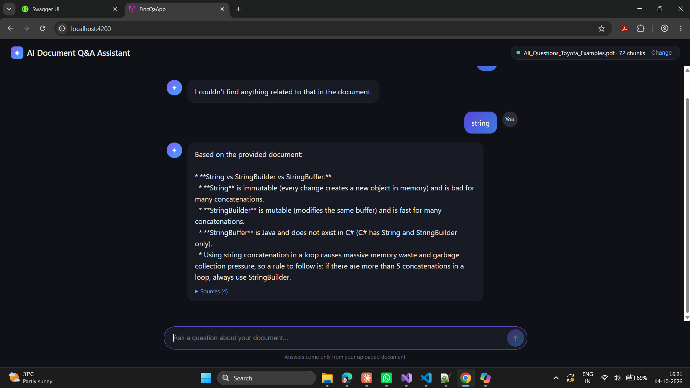

# AI Document Q&A Assistant

Upload a PDF or text file and chat with it. The app answers questions using **only the content of your document** and shows the exact passages it used as sources.

Built with **ASP.NET Core 10 Web API**, **Angular**, and the **Google Gemini API**, using a **RAG (Retrieval-Augmented Generation)** pipeline. Deployed on **Azure App Service** with a **GitHub Actions** CI/CD pipeline.

**Live demo:** https://docqa-abhilash-c6gfb8abfngdgeeq.centralindia-01.azurewebsites.net/ (free tier, so the first load can take about 30 seconds)



## Features

- Upload PDF or TXT files (drag and drop or browse)
- Ask questions in a modern dark chat interface
- Answers are grounded in the document, not guessed
- Collapsible **Sources** under each answer showing the chunks used
- Markdown rendering in answers
- Replies "I couldn't find that in the document" when the answer isn't there

## How it works (RAG pipeline)

1. **Extract:** the API reads text from the uploaded file (PdfPig for PDFs).
2. **Chunk:** the text is split into ~1,000-character pieces with 200 characters of overlap, so sentences cut at a boundary still appear whole in one chunk. **[confirm these numbers in your chunker]**
3. **Embed:** each chunk is converted to an embedding vector using the Gemini embedding API.
4. **Retrieve:** the question is embedded the same way, and chunks are ranked by **cosine similarity**. The top 5 are selected. **[say here if keyword search is still used as a fallback]**
5. **Augment:** only those chunks are placed in a prompt that tells the model to answer from the context alone.
6. **Generate:** the prompt is sent to Gemini, and the answer is returned to Angular with its sources.

## Tech stack

| Layer | Technology |
|---|---|
| Frontend | Angular (standalone components, signals), TypeScript |
| Backend | ASP.NET Core 10 Web API, C# |
| AI | Google Gemini API (generation and embeddings) |
| PDF parsing | PdfPig |
| Testing | xUnit |
| Hosting | Azure App Service (Linux, Free tier) |
| CI/CD | GitHub Actions |
| Secrets | .NET User Secrets locally, App Service application settings in Azure |

## Architecture

The ASP.NET Core API also serves the built Angular app from `wwwroot`, so the site and API share one address and no CORS setup is needed in production.

```
Browser (Angular)  ->  ASP.NET Core API  ->  Gemini API
                          |  chunk, embed, cosine search
                          v
                    in-memory DocumentStore
```

## Project structure

```
DocQaApi/          ASP.NET Core Web API (controllers, Gemini services, chunker, vector search)
DocQaApi.Tests/    xUnit tests
doc-qa-app/        Angular frontend
docs/              Screenshots
.github/workflows/ CI/CD pipeline
```

## Getting started (local)

### Prerequisites

- .NET 10 SDK
- Node.js (LTS) and Angular CLI (`npm install -g @angular/cli`)
- A free Gemini API key from [Google AI Studio](https://aistudio.google.com)

### 1. Run the API

```bash
cd DocQaApi
dotnet user-secrets set "Gemini:ApiKey" "YOUR_API_KEY"
dotnet run
```

Note the HTTPS port shown in the console (for example `https://localhost:44365`).

### 2. Run the frontend

```bash
cd doc-qa-app
npm install
ng serve
```

Open `http://localhost:4200`. The API address for local development is in `doc-qa-app/src/environments/environment.development.ts`. In production the app calls `/api` on its own address.

### Model name

The model is set in `DocQaApi/appsettings.json` under `Gemini:Model`. Free-tier model names change over time, so if you get a 404 model error, use a model listed in AI Studio.

## Tests

```bash
dotnet test
```

The suite covers cosine-similarity search (ordering, top-N, identical, perpendicular and opposite vectors) and the document store. The pipeline runs the tests before every deployment, and a failing test blocks the deploy.

## Deployment

On every push to `master`, GitHub Actions:
1. builds the Angular app and copies it into the API's `wwwroot`,
2. runs the unit tests,
3. publishes the API, and
4. deploys it to Azure App Service.

The Gemini key is stored as the App Service application setting `Gemini__ApiKey`, and the deployment credential is a GitHub repository secret. Neither is in the code.

## Limitations and roadmap

- The document is stored in memory, shared by all visitors, and cleared when the API restarts (and when the free-tier app sleeps).
- There is no authentication or rate limiting yet.
- Scanned PDFs (images only) are not supported.

Done:

- [x] Embeddings for semantic search
- [x] Render markdown in answers
- [x] Azure deployment with CI/CD
- [x] Unit tests for search and the document store

Planned:

- [ ] Per-session documents, so visitors don't share one document
- [ ] Rate limiting
- [ ] Persist documents and chat history in SQL Server
- [ ] Tests for the chunker and the controllers
- [ ] Support multiple documents

## Privacy note

When using the free Gemini tier, content sent to the API may be used by Google to improve its products. Don't upload confidential documents to the live demo.
